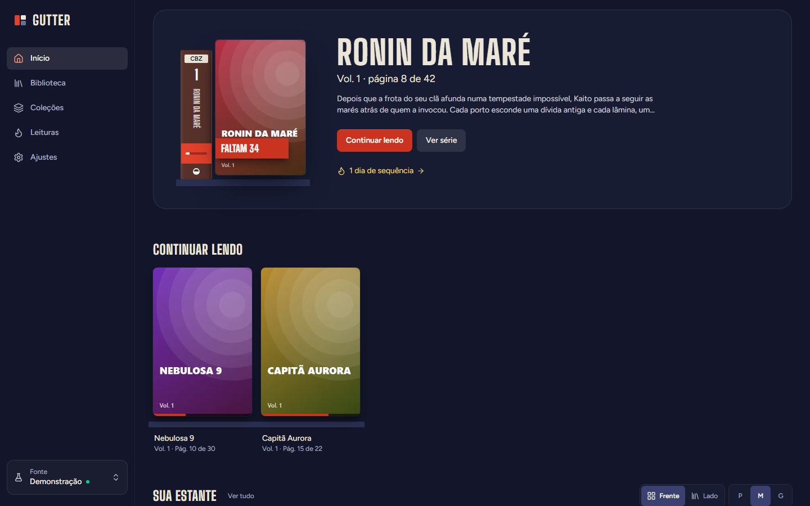
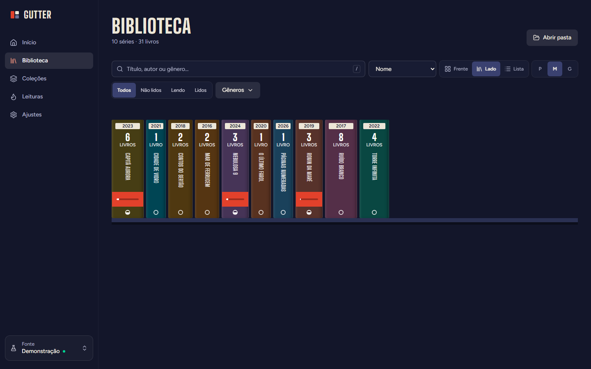
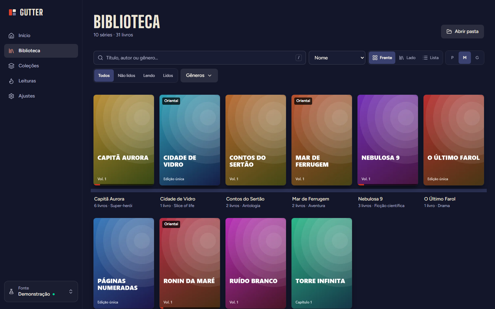
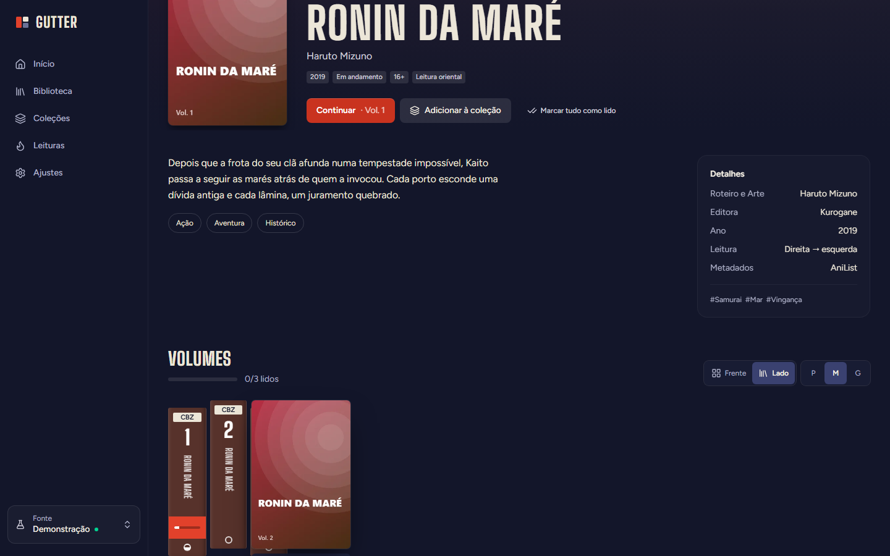
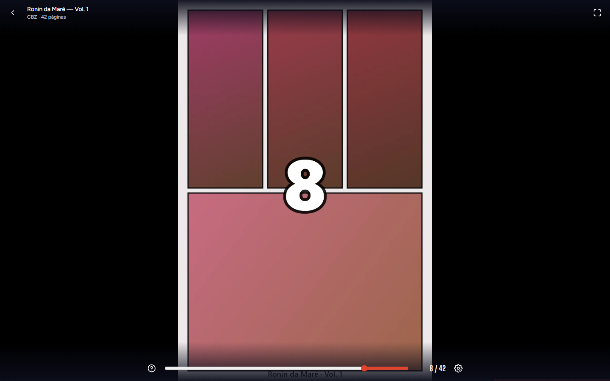
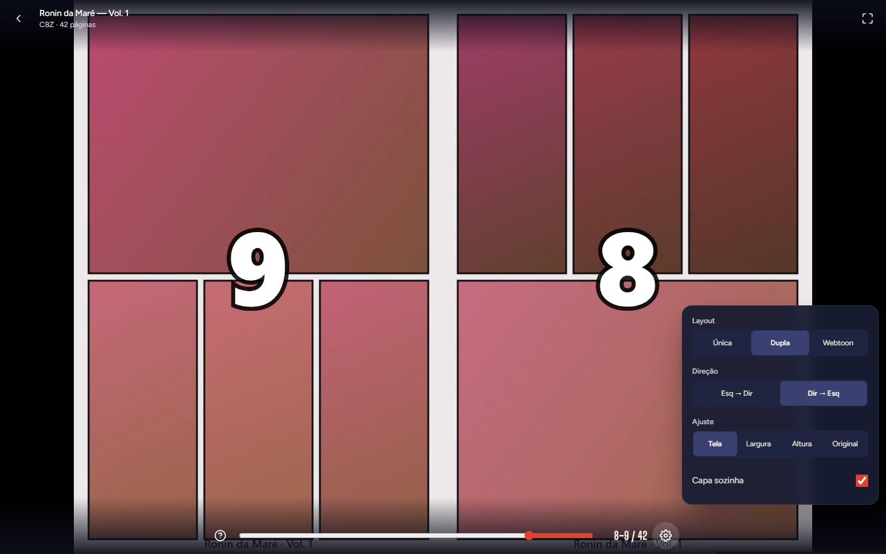
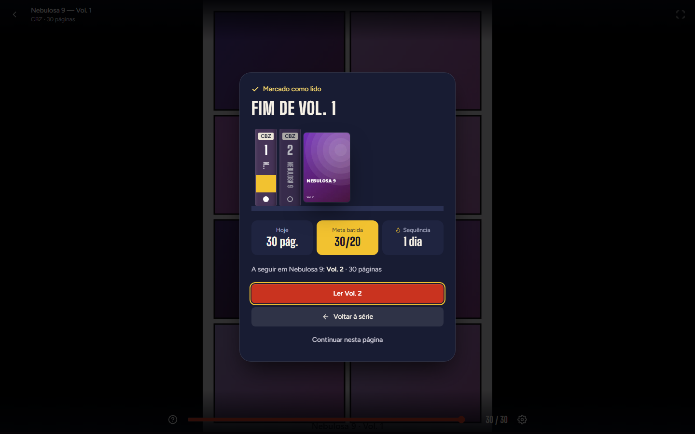
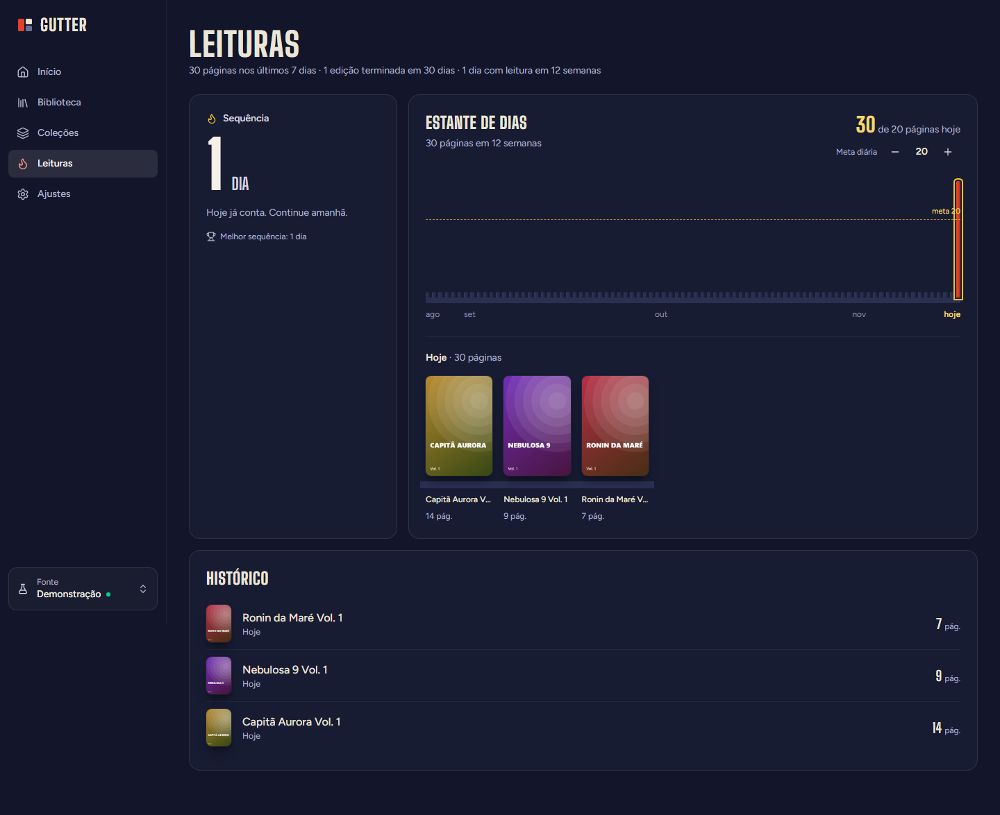
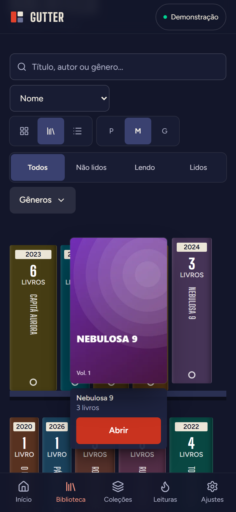

# Gutter

**Um leitor de HQs, mangás e webtoons para os arquivos que você já tem.** Abra uma pasta de CBZ/CBR direto no navegador, sem servidor, e leia do jeito certo para cada formato: ocidental, oriental (direita para a esquerda), página dupla ou rolagem vertical.

> _Gutter_ é o espaço entre os quadros de uma HQ.



> As capturas usam a biblioteca de demonstração embutida (capas geradas pelo próprio app).

## Por que mais um leitor?

- **O leitor vem primeiro.** A experiência de leitura é o produto; a biblioteca é a antessala.
- **Funciona sem servidor.** Escolha uma pasta do computador e pronto. Nada sai da sua máquina. Um servidor opcional para o homelab está a caminho.
- **HQ, mangá e webtoon como iguais.** Leitura ocidental, oriental e vertical contínua, sem um formato adaptado ao outro.
- **Bibliotecas reais são bagunçadas.** `DK #20 (2013) (Scan).cbr`, `demon knights #12.1.cbz`, pastas duplicadas, sem ComicInfo.xml: o Gutter entende e ordena mesmo assim.

## O que já funciona

### Estante de frente ou de lado
Veja a coleção pelas capas (como o Komga) ou **pelas lombadas**, com a cor tirada de cada capa, o número da edição em destaque e uma cinta (_obi_) que mostra quanto falta ler. Passe o mouse, foque com o teclado ou toque: o volume sai da estante e mostra a capa. Três tamanhos (P/M/G) e visão em lista.

| Lombadas | Capas |
|---|---|
|  |  |



### Leitor
- Página única, **página dupla** (spreads aparecem sozinhos, capa sozinha opcional) e **webtoon** com rolagem virtualizada.
- Leitura **ocidental e oriental**: setas, zonas de toque e o slider se invertem no modo oriental.
- Ajuste por tela, largura, altura ou tamanho original.
- Teclado: setas, A/D, Espaço, Home/End, `[` e `]` para o volume anterior/próximo, `F` tela cheia, `?` ajuda.
- Pré-carrega só as páginas vizinhas e libera a memória do resto.

| Página única | Página dupla, leitura oriental |
|---|---|
|  |  |

### Fim de volume que vale a pena
Ao terminar, a cinta do volume fica dourada, você vê quantas páginas leu hoje, a meta e a sequência de dias, e o próximo volume já sai da estante.



### Leituras: sequência e meta diária
Cada dia vira uma lombada na **estante de dias**, mais alta quanto mais você leu. Toque num dia para ver o que leu nele. Sequência de dias, melhor sequência e meta diária ajustável. Só conta leitura de verdade: pular páginas pelo slider não vale.



### E mais
- Coleções para agrupar séries, fixáveis no Início.
- Busca por título, autor, gênero ou tag (`/` foca a busca), filtros por status e gênero.
- Marcar como lido em lote, com **Desfazer**.
- Progresso e preferências por série salvos no navegador (IndexedDB).
- Pensado para celular, tablet e PC: alvos de toque de 44px, barra de abas no celular, "puxar o livro" com toque.

<p align="center"></p>

### Desempenho medido
Com uma pasta real de 24 edições (528 MB, CBZ e CBR misturados), no build de produção:

| Métrica | Medido | Meta |
|---|---|---|
| Ler a pasta | 100 ms | < 5 s para 1000 arquivos |
| Primeira página (CBZ) | 170 ms | < 500 ms |
| Primeira página (CBR) | 315 ms | < 500 ms |
| Virar página | ~8 ms | < 50 ms |

## Começando

Requisitos: **Node 24+**, **pnpm 12**. (Go 1.27+ só para o servidor, ainda em esqueleto.)

```sh
pnpm install
pnpm dev          # http://localhost:5173
```

Abra no Chrome ou Edge e clique em **Abrir pasta** (Biblioteca ou Início). No Chromium a pasta fica lembrada; nos outros navegadores ela é escolhida a cada visita. Sem pasta, o app mostra uma biblioteca de demonstração.

### Scripts

| Comando | O que faz |
|---|---|
| `pnpm dev` | servidor de desenvolvimento do app web |
| `pnpm check` | lint + typecheck + testes unitários (rode antes de commitar) |
| `pnpm e2e` | testes Playwright (builda e sobe o preview sozinho) |
| `pnpm build` | build de produção |
| `pnpm fixtures` | gera arquivos de teste (CBZ, PDF, CB7; CBR se `rar` estiver no PATH) |
| `pnpm lint` / `pnpm format` | Biome |

## Arquitetura

Monorepo pnpm + módulo Go.

```
apps/web/           PWA: telas, rotas, estado, fontes de dados
  src/features/     home, library, series, collections, activity, settings, reader
  src/sources/      MockSource (demo) e LocalSource (pasta do computador)
  src/db/           Dexie: progresso, preferências, coleções, registro de leitura
packages/core/      tipos, interface Source, ordenação natural, nomes de arquivo, ComicInfo
packages/reader/    componente Reader puro (não faz I/O): modos, spreads, cache de páginas
packages/workers/   Web Worker de decodificação: CBZ (zip.js) e CBR (unrar oficial em WASM)
server/             servidor Go (chi) — fase 2
deploy/             Dockerfile, docker-compose, Caddyfile
```

- **Reader puro:** recebe uma `Source` e pede páginas por índice. Demo, pasta local e (em breve) servidor implementam a mesma interface.
- **Decodificação fora da thread principal:** um worker abre os arquivos sob demanda, mantém no máximo 3 livros abertos e gera as capas; capas não expulsam o livro que você está lendo.
- **Memória com janela:** só as páginas vizinhas existem como `ObjectURL`; o resto é liberado.

O sistema visual ("The Night Shelf": chão índigo, cinta vermelha = lendo, dourado = lido) está documentado em [`apps/web/DESIGN.md`](apps/web/DESIGN.md).

## Roteiro

- [x] **Fase 0:** monorepo, CI, fixtures
- [x] **Fase 1 (em boa parte):** leitor local com CBZ/CBR, biblioteca, estante, coleções, Leituras
- [ ] PDF (pdf.js) e CB7
- [ ] Foco no balão: tocar num balão de fala e a página enquadrar o balão
- [ ] Zoom com pinça e detecção de spreads em arquivos reais
- [ ] **Fase 2:** servidor Go no homelab (SQLite, sync de progresso, OPDS para Mihon/KOReader)
- [ ] **Fase 3:** PWA offline no celular; APK via Capacitor se necessário

## Tecnologias

React 19 · TypeScript 7 · Vite 8 · Tailwind CSS 4 · Zustand · TanStack Query · Dexie · zip.js · node-unrar-js · Playwright · Vitest · Biome · Go (chi)
